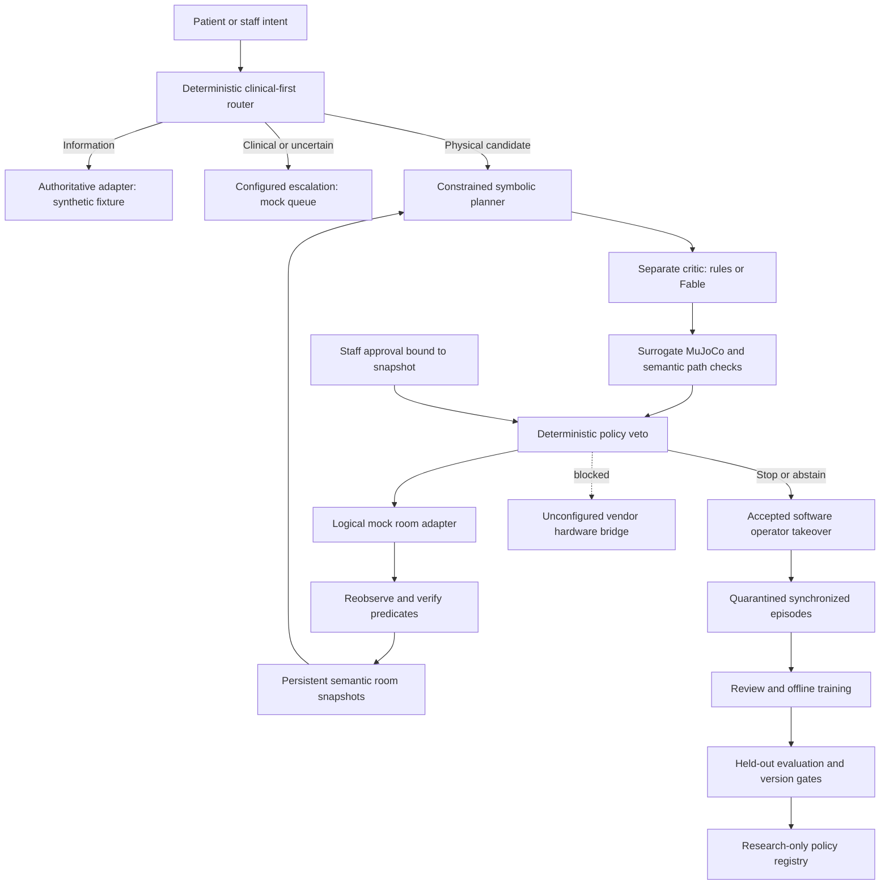

# Architecture

Vela is a modular monorepo with a single edge API process and a React application containing four views. A modular monolith gives the demo transactional state transitions without pretending that independently deployed safety services already exist. Modules have explicit boundaries suitable for later extraction.

1. **Intent:** `services/router.py` handles Route A/B/C/D. Critical lexical rules precede any model classification. Clinical/unknown text is never sent to a planner.
2. **Task planning:** `services/planner.py` binds known instances to semantic zones and generates strict `TaskProposal` and `Critique`. The default deterministic candidate and separately implemented rule critic keep the application offline. Optional provider clients can propose/critique synthetic scenes; neither exposes actuator tools.
3. **Execution:** `robot/mock.py` changes and reobserves an in-memory synthetic scene, persisted transactionally. The learning runtime emits bounded synthetic candidate deltas only. It is not connected to this placement adapter or to a motor controller.
4. **Safety:** `services/safety.py` checks clinical/object authority, snapshot freshness and hashes, approval, health, E-stop, watchdog flag, person geometry, payload, keep-outs and distribution. The software veto is independent of model output, but runs in the same process. A separate physical safety controller is a production requirement.

SQLite WAL stores rooms, snapshots, tasks, requests, benchmarks and append-only events. Transactions serialize approval, execution, room mutation and cancel operations. The hash chain detects event edits; a privileged database administrator could replace the entire database, so this is not tamper-proof external audit storage. Learning records live separately and require review before export; operational requests never enter training automatically.

All scene distances and control thresholds are synthetic fixtures. Semantic plan validation is a straight object-path diagnostic plus a separate MuJoCo engine run. It is not full swept-robot, grasp, force or payload certification. The vendor adapter refuses every physical execution call regardless of supplied approval.

The API supports roles scoped to bedside requests versus staff/operator/research actions. Loopback demo mode permits explicit role switching. Token mode requires configured secrets and an external TLS origin. Deploy one worker; sessions and operator coordination are process-local. SSO, hardware device identity, streaming perception and separate safety hardware remain integration work.

